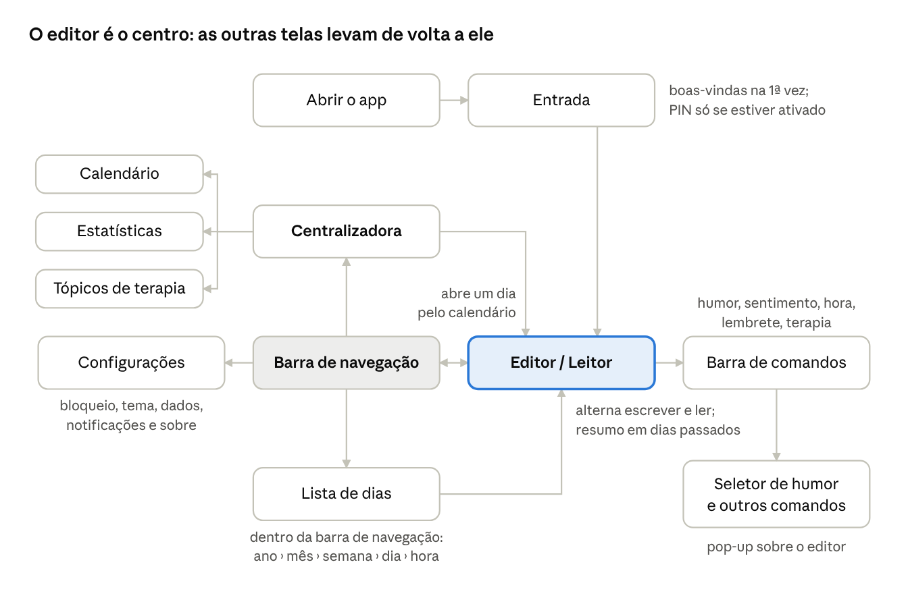

# Diário — Escopo de Design (UI/UX)

15/10/2026 · Darci

## Introdução

**O produto.** O Diário é um app de diário pessoal para celular e computador. Cada dia é um texto livre, e humor, sentimentos, horários e assuntos para a terapia são escritos no próprio texto com comandos simples. Os botões da interface só inserem ou editam esses comandos. A partir deles, o app monta sozinho estatísticas e um resumo de cada dia, sem inteligência artificial. O app é open source e 100% offline: os dados ficam só no aparelho, sem conta nem login.

**Como o trabalho anda.** O design vem primeiro: fluxogramas, protótipos e componentes no Figma. Só depois começa a programação, que fica fora do prazo desta cadeira. Este documento é a fonte da verdade do design: o grupo discute as ideias e as decisões são registradas aqui. Mais tarde, o escopo do código (ESCOPO.md e CLAUDE.md, no repositório) será atualizado a partir dele.

**O desafio de design.** Fazer um editor de texto parecer um diário acolhedor, tornar os comandos fáceis de descobrir sem virar formulário, e mostrar o humor em cores sem depender só de cor.

**Todo comando é texto.** Humor, sentimento, hora, lembrete, apelido e terapia não são campos de formulário: são palavras escritas no próprio texto do dia, seguidas de uma barra. O texto é a única fonte de verdade. Os botões da barra de comandos só escrevem ou trocam essas palavras no texto, como um atalho; a pessoa pode sempre digitá-las à mão. Um comando escrito errado (como `humor/7`) continua no texto como texto comum e ganha um aviso discreto ao lado.

| Comando | Exemplo | O que faz |
| --- | --- | --- |
| `humor/N` | `humor/4` | Registra como a pessoa se sente no momento, numa escala de 1 (me sinto mal) a 5 (me sinto bem). Na leitura, vira cor e emoji, e é o que aparece no calendário |
| `sentimento/` | `sentimento/an1` | Registra um sentimento por sigla e intensidade de 1 a 3. `an1` quer dizer "levemente ansioso". Na leitura, vira emoji |
| `hora/` | `hora/14:32` | Abre um novo momento do dia com horário. Na leitura, vira o cabeçalho do bloco |
| `lembrete/` | `lembrete/ ligar pro dentista` | Escrito num dia futuro, aparece em destaque quando esse dia chega |
| `apelido/` | `apelido/ o dia do campeonato` | Dá um nome ao dia inteiro, que aparece na lista de dias e no cabeçalho da leitura |
| `terapia/` | `terapia(T)/ falar sobre o trabalho /terapia` | Registra um assunto para levar à terapia. O tópico vai para a aba "Tópicos de terapia" |

**Regras dos comandos**

- **Humor:** cada momento do dia tem no máximo um `humor/`. Se a pessoa digita um segundo `humor/` num momento que já tem humor, o app insere sozinho um `hora/` com a hora atual antes dele, abrindo um momento novo. O botão de humor nunca abre momento novo: se o momento já tem humor, ele só troca o valor.
- **Sentimento:** cabe mais de um no mesmo momento. As siglas são uma lista fixa, definida pelo grupo, cada uma com intensidade 1 (levemente), 2 (moderadamente) ou 3 (muito). Por enquanto, os sentimentos não aparecem no calendário.
- **Terapia, ao escrever:** ao digitar `terapia/`, o texto que vem depois aparece em outra cor, para a pessoa ver que está dentro do tópico. Um tópico pode ter mais de um parágrafo: um Enter começa um parágrafo novo dentro do tópico. Dois Enters seguidos (uma linha em branco) fazem o app fechar o tópico sozinho com `/terapia`, e o trecho fica com um destaque de outra cor.
- **Terapia, aberto ou fechado:** a marca fica junto do comando. O app escreve sozinho `terapia(T)/` para um tópico aberto. Quando a pessoa marca o tópico como concluído na aba "Tópicos de terapia", ele sai da aba e o comando vira `terapia(F)/`. A pessoa também pode trocar a marca à mão.

## Objetivos e princípios de design

O design deve deixar escrever o dia em poucos segundos e reler a semana num relance. Os princípios abaixo servem de critério para decidir entre alternativas.

1. **O texto é a verdade.** Botões e seletores são atalhos que escrevem comandos no texto. A interface nunca mostra um dado que não esteja no texto. Ao exportar os dados, tudo sai como um documento de texto puro.
2. **Open source e offline, com privacidade em primeiro lugar.** O app diz claramente que os dados ficam no aparelho, que não há criptografia e que nada é enviado para a internet.
3. **Autonomia e personalização.** Quem quiser pode nunca usar comando nenhum e só escrever. As notificações são opcionais. O usuário tem autonomia sobre quase tudo.
4. **Comandos descobríveis, não obrigatórios.** Quem nunca leu as instruções deve conseguir registrar o humor pelo botão. Quem conhece pode digitar `humor/4`.
5. **Comandos são texto, mas chegam ao usuário "polidos".** Na leitura, `humor/4` vira um emoji; ao tocar para editar, o texto do comando aparece de novo.
6. **Escrever vem primeiro.** Ao abrir o app, o cursor já está no dia de hoje, sem distrações.
7. **Mobile primeiro.** Todas as telas nascem em 390 × 844. O desktop é adaptação no fim.
8. **Calma, não gamificação.** Sem sequências nem metas que cobrem a pessoa. Lembretes para escrever só existem se ela ligar nas Configurações. Tom acolhedor e discreto.

## Público e pesquisa

O público são pessoas que querem registrar o dia e o humor sem esforço, principalmente no celular. A pesquisa é leve, para caber no prazo: serve para validar decisões, não para descobrir o produto do zero.

**Cenários principais**

- **Registro rápido:** no ônibus, a pessoa abre o app, escreve duas linhas e marca o humor em menos de 30 segundos.
- **Momentos do dia:** registra a manhã e, à tarde, volta para registrar outro humor num novo bloco com horário.
- **Releitura:** no fim do mês, olha o calendário para ver como se sentiu e abre um dia específico.
- **Recado para o futuro:** escreve um lembrete num dia que ainda vai chegar.
- **Pauta da terapia:** durante a semana, anota assuntos com `terapia/`. Antes da sessão, abre a aba de tópicos para ver o que está em aberto e, depois, marca o que já falou.

**Perguntas que o teste precisa responder**

- A pessoa entende, sem ajuda, como marcar o humor?
- Ela percebe que `humor/4` no texto e o botão fazem a mesma coisa?
- O aviso de comando inválido é notado sem assustar?
- Ela entende que os dados ficam só no aparelho?

## Fluxos e protótipo

Depois da entrada, o app abre no editor do dia de hoje. A barra de navegação (por enquanto, uma barra lateral) traz a lista de dias e os caminhos para a Centralizadora e para as Configurações. O protótipo no Figma deve percorrer estes caminhos sem becos sem saída.

## Telas mobile

São 15 telas, que cobrem o app completo. Os quadros têm 390 × 844, e os estados de cada tela ficam lado a lado.

| # | Tela | Estados a desenhar |
| --- | --- | --- |
| 1 | Boas-vindas (1 ou 2 telas) | Explica que os dados ficam no aparelho; mostra os comandos principais |
| 2 | Desbloqueio | Pelo bloqueio do celular (digital, rosto ou senha); pelo PIN do app: vazio, digitando, PIN errado |
| 3 | Hoje (editor) | Dia vazio com texto de exemplo; teclado aberto com barra de comandos; dia com vários blocos; aviso de comando inválido; lembrete em destaque no topo; tópico de terapia sendo escrito (texto em outra cor) e fechado (trecho destacado); comandos como chips visuais |
| 4 | Seletor de humor e outros comandos (pop-up) | Pop-up aberto sobre o editor; humor de 1 a 5, um selecionado; troca de humor num bloco que já tem; sentimentos com sigla e intensidade de 1 a 3, vários selecionados |
| 5 | Lista de dias (na barra de navegação) | Pastas que abrem e fecham: ano (só com registros em mais de um ano) › mês › semana (de domingo a sábado) › dia › momentos do dia (os blocos abertos com `hora/`); barra aberta e fechada; vazia; dia com apelido; atalhos para a Centralizadora e as Configurações |
| 6 | Modo leitura do dia | Aberto a partir do próprio dia, alternando entre escrever e ler; resumo do dia no topo, só em dias passados; `humor/4` vira cor e emoji, `sentimento/` vira emoji, `hora/` vira cabeçalho do bloco, `terapia/` aparece destacado; apelido no cabeçalho |
| 7 | Edição de um dia | Mesmo editor de Hoje com outra data; dia futuro com a dica do `lembrete/` |
| 8 | Centralizadora | Reúne o calendário, os tópicos de terapia em aberto e as estatísticas, com caminho para cada um |
| 9 | Calendário mensal | Célula vazia, com 1 ponto, com vários, acima do limite, hoje, selecionada, com lembrete; tocar num dia abre o dia direto |
| 10 | Tópicos de terapia | Lista dos tópicos em aberto, com o dia em que foram escritos; marcar como concluído (sai da lista e vira `terapia(F)/` no texto); abrir o dia do tópico; lista vazia |
| 11 | Estatísticas | Frases geradas automaticamente (ex.: "você se sente ansioso na maioria das terças") e gráficos de humor e sentimentos; poucos dados; sem dados |
| 12 | Configurações | Exportar e importar; confirmação antes de importar; tema claro ou escuro; bloqueio ligado ou desligado; lembrete para escrever ligado ou desligado, com horário |
| 13 | Escolher bloqueio | Usar o bloqueio do celular ou criar um PIN próprio; criar PIN, confirmar, os dois não coincidem; trocar PIN |
| 14 | Instalar o app | Convite discreto para pôr na tela inicial |
| 15 | Sobre e privacidade | Repositório, licença, aviso de que não há criptografia |

**Estados que costumam ser esquecidos:** primeiro uso, erro ao salvar, texto muito longo, dia com muitos blocos, e confirmação antes de substituir dados na importação.

## Telas desktop (depois)

## Componentes (fazer tabela depois do protótipo de baixa)

| Componente | Variantes e estados | Usado em | Nível no código |
| --- | --- | --- | --- |
|  |  |  |  |
|  |  |  |  |

A navegação e a célula do calendário dependem de decisões ainda em aberto. Dá para começar pelos outros componentes enquanto o grupo decide.

## Fundamentos do design system

São 13 fundamentos que o grupo precisa definir antes de desenhar componentes e telas, porque todo o resto depende deles. O design system da primeira unidade é a base: o que já estiver nele basta confirmar e marcar como decidido. Tudo vira variável do Figma, nunca cor ou medida solta numa tela.

| Fundamento | O que definir | Ponto de partida | Situação |
| --- | --- | --- | --- |
| Cores de base | Fundo, superfícies, texto, bordas, destaque e aviso, nos temas claro e escuro | Célula do calendário com fundo neutro, sem degradê, e contraste com os pontos de humor | A definir |
| Fontes | Fonte da interface e fonte do texto do diário (a mesma ou uma serifada para leitura) | Gratuitas, com licença aberta e acentos do português (ex.: Google Fonts) | A definir |
| Tipografia | Escala de tamanhos, pesos e entrelinhas para títulos, texto do diário, rótulos e legendas | Texto do editor com pelo menos 16 px no celular e entrelinha confortável; testar a leitura no celular | A definir |
| Ícones | Biblioteca e estilo (linha ou preenchido, espessura, cantos); ícones de hora, humor, sentimento, lembrete, terapia, calendário, dias, estatísticas, configurações e cadeado | Uma biblioteca aberta, compatível com a licença MIT e no estilo do design system existente | A definir |
| Espaçamento e grid | Unidade base, margens laterais, grid do celular e do desktop | Unidade de 4 ou 8 px; alvos de toque de no mínimo 44 px, inclusive nas células do calendário | A definir |
| Cantos, sombras e bordas | Raio padrão e elevação do pop-up e da barra de navegação | Seguir o design system existente | A definir |
| Movimento | Como abrem o pop-up, a barra de navegação, as pastas da lista de dias e a troca entre escrever e ler | Curto e simples; respeitar a opção de reduzir movimento | A definir |
| Paleta dos 5 humores | As cores das variáveis `mood/1` a `mood/5` | Espectro que varia também a luminosidade; testado para daltonismo e nos dois temas | A definir |
| Emojis de humor | Um emoji ou ícone por nível de 1 a 5: emoji do sistema (muda de aparelho para aparelho) ou desenho próprio | Sempre junto da cor | A definir |
| Siglas dos sentimentos | A lista fixa de sentimentos, a sigla de cada um (ex.: `an` = ansioso) e como as intensidades de 1 a 3 aparecem | Siglas curtas e fáceis de lembrar; um emoji ou ícone por sentimento | A definir |
| Comandos no texto | Estilo de `humor/`, `sentimento/` e `hora/` dentro do editor; cor do texto de um tópico de terapia aberto e destaque do tópico fechado | Diferente do texto comum, mas discreto; o destaque da terapia não pode depender só de cor | A definir |
| Cabeçalho de bloco e avisos | Estilo do horário na leitura (`hora/14:32` vira cabeçalho) e do aviso de comando inválido | Aviso discreto, com cor e ícone | A definir |
| Gráficos das estatísticas | Tipos de gráfico (humor ao longo do tempo, sentimentos mais frequentes) e o estilo deles | Usar as cores dos humores; sempre com rótulos, sem depender só de cor | A definir |

**Tema escuro:** todas as cores viram variáveis com dois modos (claro e escuro) desde o início. Assim o tema escuro sai das mesmas telas, sem redesenhar nada.

## Acessibilidade

A meta é o nível AA da WCAG em todas as telas. Os pontos mais sensíveis são as cores de humor no calendário e o destaque dos tópicos de terapia.

- [ ] Contraste de texto de pelo menos 4,5:1 (texto grande: 3:1), nos temas claro e escuro
- [ ] Pontos de humor com contraste de pelo menos 3:1 sobre o fundo neutro da célula do calendário
- [ ] Paleta de humor testada em simulação de daltonismo; as 5 cores variam também na luminosidade
- [ ] Humor, sentimento e tópico de terapia nunca só por cor: sempre com emoji, ícone, número ou texto
- [ ] Alvos de toque de no mínimo 44 × 44 px, inclusive nas células do calendário e nas pastas da lista de dias
- [ ] Textos alternativos anotados no Figma para ícones, emojis e gráficos (ex.: "humor 4 de 5", "levemente ansioso")

## Regras combinadas

- Tela e estado são coisas diferentes: estados da mesma tela ficam lado a lado, na mesma linha.
- Quadros nomeados com tela e estado: `Hoje / vazio`.
- Toda cor e espaçamento vem de variável; nada solto.
- Componentes antes de telas: as telas usam só instâncias da biblioteca.

## Fluxos que o protótipo precisa mostrar

1. **Primeiro uso:** boas-vindas → Hoje com texto de exemplo.
2. **Registrar o humor pelo botão:** Hoje → barra de comandos → pop-up do seletor → humor aparece no texto.
3. **Registrar sentimentos:** pop-up do seletor → escolher um ou mais sentimentos e a intensidade → `sentimento/an1` aparece no texto.
4. **Novo momento do dia:** bloco com humor → botão de hora → novo bloco com horário → outro humor.
5. **Comando inválido:** digitar `humor/7` → aviso discreto ao lado da linha.
6. **Anotar um assunto para a terapia:** digitar `terapia/` → o texto fica em outra cor → Enter duas vezes → o app fecha com `/terapia` e destaca o trecho → o tópico aparece na aba de tópicos.
7. **Concluir um tópico de terapia:** Centralizadora → Tópicos de terapia → marcar como concluído → o tópico sai da lista e vira terapia(F)/ no texto do dia.
8. **Reler um dia:** barra de navegação → lista de dias → abrir as pastas (ano, mês, semana) → tocar num dia → resumo do dia no topo → alternar entre ler e escrever.
9. **Calendário:** Centralizadora → calendário → tocar num dia → o dia abre direto.
10. **Ver estatísticas:** Centralizadora → estatísticas → frases e gráficos; estado com poucos dados.
11. **Lembrete:** abrir um dia futuro no calendário → escrever `lembrete/` → quando o dia chega, o lembrete aparece em destaque no topo de Hoje.
12. **Apelido do dia:** escrever `apelido/` → o apelido aparece na lista de dias e no cabeçalho do modo leitura.
13. **Bloqueio:** Configurações → escolher entre o bloqueio do celular ou um PIN próprio → fechar e abrir o app → desbloquear (inclui erro).
14. **Lembrete para escrever:** Configurações → ligar a notificação e escolher o horário.
15. **Exportar e importar:** Configurações → exportar; importar → confirmação antes de substituir os dados.
16. **Tema escuro:** alternar o tema e percorrer as telas principais.

No protótipo, use transições simples e o teclado do sistema como imagem para mostrar a barra de comandos acima dele.

## Cronograma

O roadmap do grupo, do Figma. O primeiro marco é fechar as funcionalidades até terça, 20/10.

1. **Fechar funcionalidades** (até terça, 20/10).
2. **Em paralelo:**
    - **Protótipo de baixa fidelidade:** identificar os componentes e coletar referências de funcionalidades e de telas.
    - **Fundamentos:** definir os itens da tabela de fundamentos.
3. **Fechar a lista de funcionalidades.**
4. **Fazer os componentes.**
5. **Protótipo de alta fidelidade**, já com os componentes feitos.

Fora da sequência, o grupo ainda vai discutir novas funcionalidades e o modelo de negócio.

## Em aberto

Estas decisões ainda precisam ser tomadas pelo grupo:

- A lista fixa de sentimentos e as siglas de cada um.
- Se, e como, os sentimentos vão aparecer no calendário.
- O formato final da barra de navegação. Por enquanto é uma barra lateral, mas pode mudar durante o desenho das telas.
- Quais frases e gráficos as estatísticas vão mostrar, e a partir de quantos dias de registro elas aparecem.
- Como o resumo do dia apresenta humor, sentimentos, tópicos de terapia e lembretes.
- Tamanho e limite dos pontos de humor por dia no calendário.

## Ideias em avaliação

- **Registrar comportamentos:** anotar coisas como "bebi", "dormi tarde" ou "fumei", talvez como um novo comando. Ainda não decidido.

## Observações

- **Notificações:** o lembrete para escrever é opcional e fica nas Configurações. Como o Diário é um app web instalável, a notificação funciona bem no Android e no computador; no iPhone, só funciona se a pessoa instalar o app na tela inicial.
- **Sem inteligência artificial:** as estatísticas e o resumo do dia são gerados por regras simples a partir dos comandos, e o app continua 100% offline.

## Fora do escopo por enquanto

- Exportar dias específicos para o psicólogo e qualquer recurso ligado a modelo de negócio.
- Login, contas, sincronização e criptografia.

